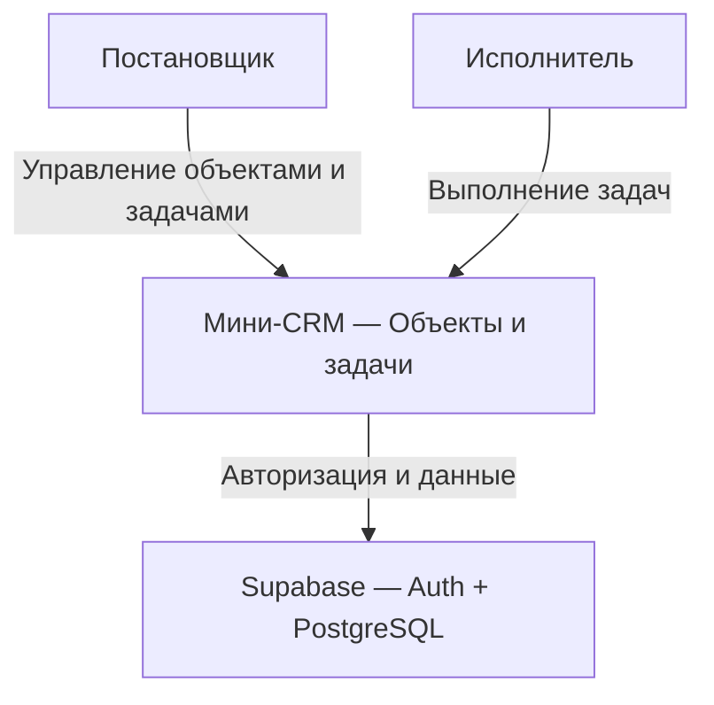

# C1 — контекст системы

Контекст реализованной системы после Stage 5. Cloud и статический хостинг —
целевая среда публикации; в Stage 6A они не разворачиваются. Локальный Supabase
поддерживает те же прикладные Auth/API/БД.

Постановщики видят все объекты и задачи, исполнители — только свои задачи
и объекты с такими задачами. В Supabase выполняются авторизация, хранение,
проверки прав и статусов, ведение истории.

Пользователи и роли заводятся администратором в Supabase; локально предусмотрен
повторяемый скрипт аккаунтов. Отдельного
административного экрана CRM нет. Интеграции с hh.ru, почтой и внешними учётными
системами не входят в объём.

Система обслуживает одну общую базу компании, разделения на организации нет.
Клиентская SPA — недоверенная сторона; граница доступа проходит в PostgreSQL
через RLS, grants и явные проверки SQL RPC. Административные полномочия вне
модели прав обычного пользователя. Подробнее: [C2](c2.md),
[модель безопасности](security-model.md), [README](../README.md).
