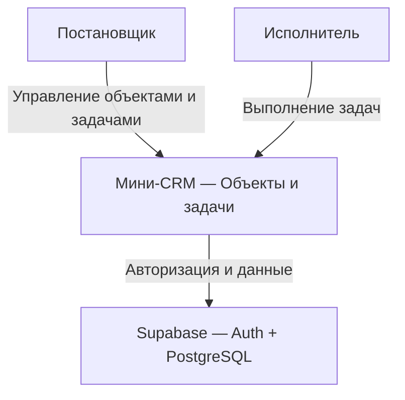

# C1 — контекст системы

Основано на архитектуре, предоставленной пользователем. Диаграмма описывает
целевую систему; в Foundation реализованы только UI-заглушки.

Постановщики видят все объекты и задачи, исполнители — только свои задачи
и объекты с такими задачами. В Supabase выполняются авторизация, хранение,
проверки прав и статусов, ведение истории.

Пользователи и роли заводятся администратором вручную в Supabase; отдельного
административного экрана CRM нет. Интеграции с hh.ru, почтой и внешними учётными
системами не входят в объём.
