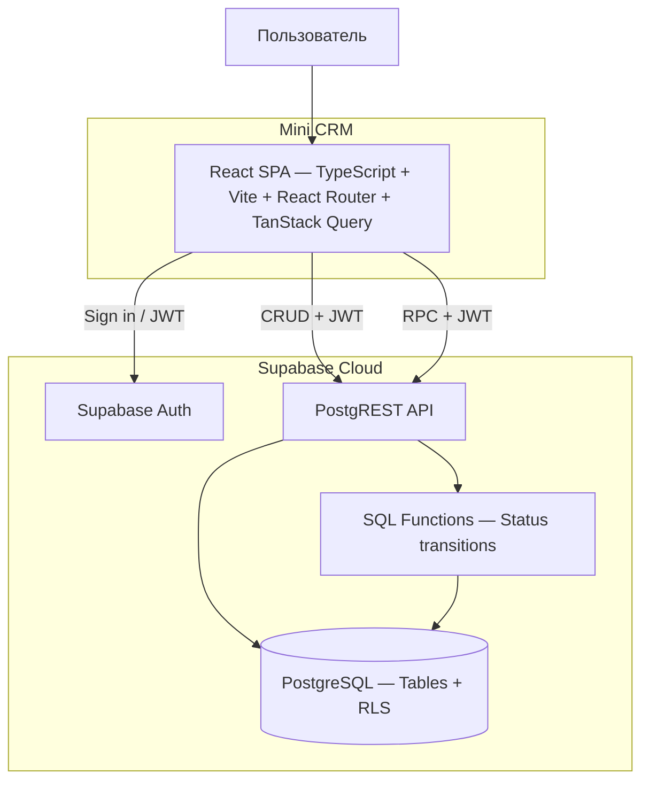

# C2 — контейнеры

Основано на архитектуре, предоставленной пользователем. Контейнер означает
среду выполнения или сервис, не Docker. На Stage 3A SPA подключён к Supabase
Auth и чтению собственного profiles через PostgREST. Бизнес-таблицы закрыты;
CRUD и RPC на диаграмме остаются целевой архитектурой Stage 3B и следующих этапов.

| Элемент | Ответственность |
| --- | --- |
| React SPA | Экраны и навигация, TanStack Query для получения и обновления серверных данных |
| Supabase Auth | Вход email/пароль и сессия; открытая регистрация отключена |
| PostgREST API | Чтение, разрешённый CRUD и RPC с JWT-контекстом пользователя |
| SQL-функции | Критические изменения с проверками прав, переходов и транзакцией |
| PostgreSQL | Таблицы, RLS, ограничения целостности и достоверная история |

Критические изменения (включая статусы и переназначение) проходят через
защищённые SQL-функции. Стрелка CRUD не разрешает произвольную запись в таблицы:
прямые запросы ограничиваются грантами и RLS, обход RPC запрещён на уровне БД.
Функции с повышенными привилегиями сами проверяют пользователя и права.

Браузер — недоверенная среда. Скрытие кнопок и маршрутов не защищает данные.
Роль хранится в защищённом `profiles`. Клиент использует только публичный ключ
Supabase и JWT сессии; service_role/secret-ключи в клиент не передаются.

TanStack Query показан как часть целевой архитектуры; в Foundation без данных
он ещё не подключён. SPA в будущем раздаётся статическим хостингом с fallback
на `index.html`. SQL доставляется версионированными миграциями.

## Реализация сессии Stage 3A

Один `AuthProvider` хранит состояние инициализации, сессию и загруженный профиль.
Supabase SDK восстанавливает/обновляет токены; onAuthStateChange синхронизирует
состояние, cleanup снимает подписку. Запрос профиля выполняется вне callback.
Поколение запроса и AbortController не позволяют устаревшему профилю восстановить
доступ после выхода/смены пользователя. Роль берётся только из profiles.

Для profiles добавлена SELECT policy `profiles_select_own` с `id = auth.uid()`
и grant чтения только колонок id/role для authenticated. Профиль не редактируется
клиентом. Tables objects/tasks/task_status_history не получили ни policies, ни прав.
TanStack Query пока не подключён: кеш бизнес-данных в этот этап не входит.
Административный локальный Node-скрипт создания аккаунтов не является backend
приложения и не импортируется браузерным кодом.
