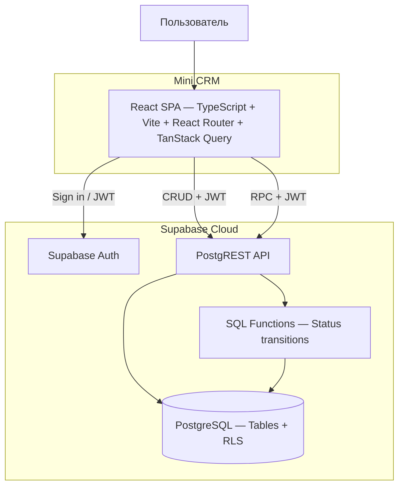

# C2 — контейнеры

Основано на архитектуре, предоставленной пользователем. Контейнер означает
среду выполнения или сервис, не Docker. Сейчас существует только SPA-заглушка.

| Элемент | Ответственность |
| --- | --- |
| React SPA | Экраны и навигация, TanStack Query для получения и обновления серверных данных |
| Supabase Auth | Вход email/пароль и сессия; открытая регистрация отключена |
| PostgREST API | Чтение, разрешённый CRUD и RPC с JWT-контекстом пользователя |
| SQL-функции | Критические изменения с проверками прав, переходов и транзакцией |
| PostgreSQL | Таблицы, RLS, ограничения целостности и достоверная история |

Критические изменения (включая статусы и переназначение) проходят через
защищённые SQL-функции. Стрелка CRUD не разрешает произвольную запись в таблицы:
прямые запросы ограничиваются грантами и RLS, обход RPC запрещён на уровне БД.
Функции с повышенными привилегиями сами проверяют пользователя и права.

Браузер — недоверенная среда. Скрытие кнопок и маршрутов не защищает данные.
Роль хранится в защищённом `profiles`. Клиент использует только публичный ключ
Supabase и JWT сессии; service_role/secret-ключи в клиент не передаются.

TanStack Query показан как часть целевой архитектуры; в Foundation без данных
он ещё не подключён. SPA в будущем раздаётся статическим хостингом с fallback
на `index.html`. SQL доставляется версионированными миграциями.
