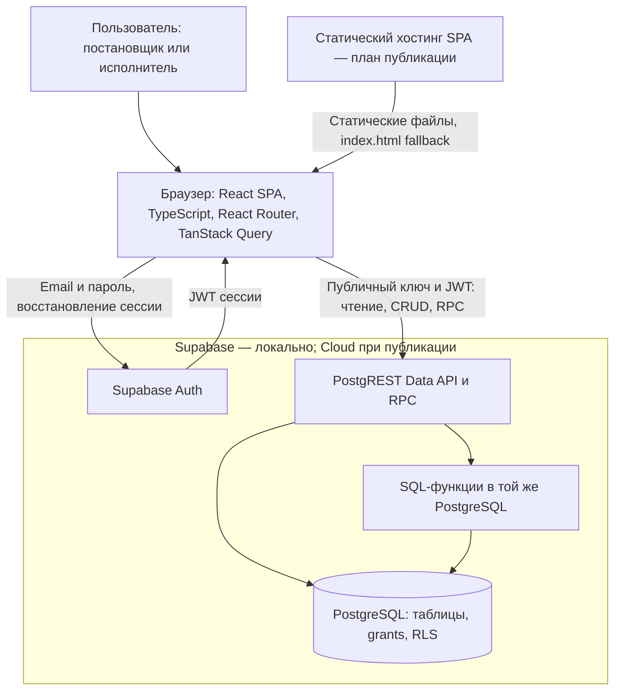

# C2 — контейнеры системы

Текущая реализация Stage 1–5. «Контейнер» здесь означает приложение/сервис,
не обязательно Docker. Supabase работает локально; Cloud и статический хостинг
предусмотрены для публикации, но Stage 6A их не создаёт.

| Элемент | Реальная ответственность |
| --- | --- |
| React SPA | формы, списки, карточки, workflow, история, назначение, UX-проверки |
| AuthProvider + SDK | один источник сессии и профиля, восстановление, refresh, cleanup подписки |
| TanStack Query | бизнес-запросы, отдельный QueryClient для текущего id/роли; отмена и очистка при выходе |
| Auth | email/password, JWT; закрытая регистрация в локальной конфигурации |
| PostgREST | исполнение запросов/RPC в контексте JWT пользователя |
| PostgreSQL | целостность, RLS, гранты столбцов, транзакции и row locks |
| SQL-функции | защищённые команды и ограниченное чтение email Auth |

## Потоки данных

Профиль читается Data API с `profiles_select_own`. Списки объектов/задач и обычный
CRUD ограничены RLS и grants. `objects` можно создавать/редактировать по name/address;
у задач прямо редактируются только title/description. Все изменения — только manager.
Создание задачи выполняет `create_task`, автор и new задаются сервером.

Карточка использует `read_task`, история — `read_task_history`: оба read-only RPC
возвращают email только для доступной задачи с явной проверкой пользователя,
роли и назначения. Выбор исполнителя использует manager-only `list_executors`.
Это не открывает таблицу Auth или RLS профилей.

`transition_task` и `reassign_task` проверяют роль/назначение и блокируют задачу
FOR UPDATE. Первая атомарно меняет статус и добавляет историю; вторая меняет
только исполнителя при любом статусе. Начальную историю пишет create_task.
RPC — функции в той же БД, не отдельный backend или Edge Functions.

## Границы доверия

Браузер недоверенный. Route guards не являются защитой данных. Роли берутся
из profiles, не JWT user_metadata. Клиент содержит только публичный ключ и JWT
пользователя; административные credentials туда не передаются.

RLS-зависимости: objects → tasks → profiles; history → tasks → profiles.
Обратных зависимостей нет. SECURITY DEFINER может обходить RLS, поэтому RPC
выполняют собственные проверки; пустой search_path и ограниченный EXECUTE обязательны.
Администратор БД и service_role не ограничиваются как обычные пользователи.

После мутаций инвалидируются crm-query keys; после ошибки workflow данные тоже
перечитываются. Оптимистичного статуса и mutation retry нет. Realtime нет:
чужое переназначение влияет на новые запросы, не стирает уже загруженную страницу.

## Доставка и вспомогательные инструменты

Vite собирает SPA в dist. Хостинг должен поддерживать fallback на index.html для
React Router; настройка Netlify ещё не добавлена. SQL доставляется шестью
версионированными миграциями. Auth-настройки Cloud проверяются отдельно.
Локальные Node-скрипты аккаунтов/тестов работают вне браузера и не являются backend.

Связанные документы: [C1](c1.md), [ERD](erd.md),
[модель безопасности](security-model.md), [ADR-003](adr/ADR-003.md).
