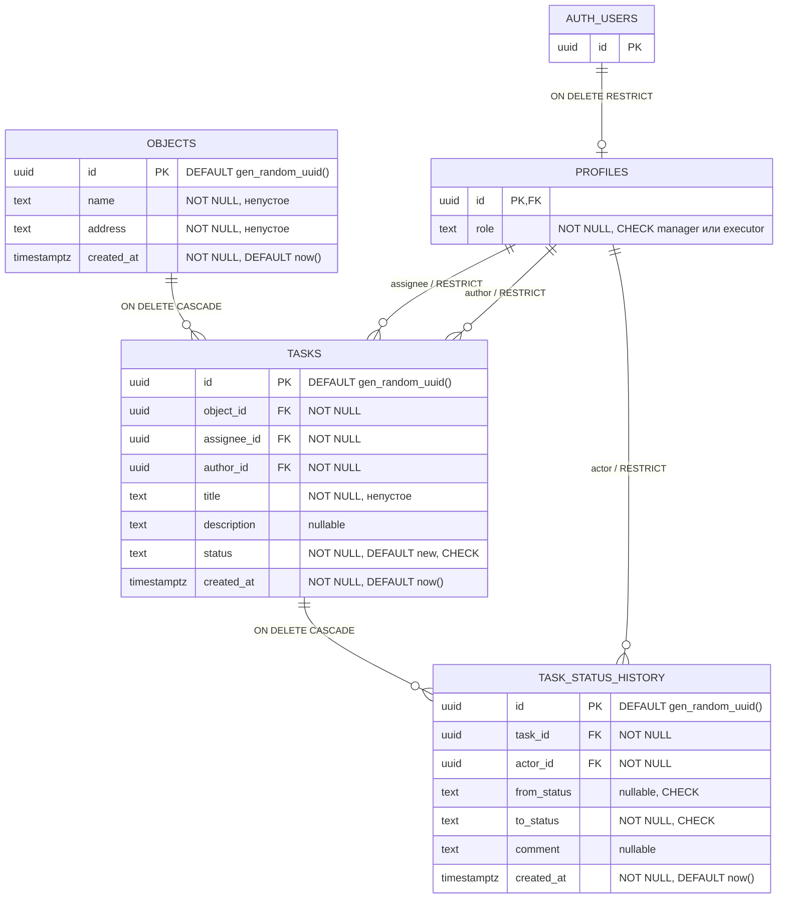

# ERD — схема Stage 2 и доступ к профилю Stage 3A

Реализована миграцией `supabase/migrations/20261105000000_create_crm_schema.sql`.
Схема подготовлена для Supabase; Stage 3A подключает Auth и чтение профиля
через переменные окружения. Облачный проект этим этапом не разворачивается.
`auth.users` — существующая таблица Supabase, миграция её не создаёт.



## Ограничения и удаление

- Роль: `manager` или `executor`, CHECK + NOT NULL.
- Все три поля статуса проверяются CHECK: `new`, `in_progress`, `in_review`,
  `accepted`, `rework`. `from_status` допускает NULL, остальные статусы — нет.
- `objects.name`, `objects.address`, `tasks.title` должны содержать хотя бы один
  непробельный символ (`~ '[^[:space:]]'`): пустая строка, пробелы, табы и переводы
  строк отклоняются. Введённые значения не обрезаются и не переписываются.
- `description` и `comment` допускают NULL и пустую строку по заданию Stage 2.
- Все ID — UUID; для объектов, задач и истории БД генерирует ID по умолчанию.
  `profiles.id` задаётся существующим `auth.users.id`.
- Hard delete: удаление объекта каскадно удаляет задачи и их историю; удаление
  задачи — только её историю. Несвязанные записи и профили остаются.
- `profiles.id → auth.users.id ON DELETE RESTRICT`: пользователь с профилем
  не удаляется. Ссылки author/assignee/actor на профиль также RESTRICT.
  Это исключает каскадное уничтожение бизнес-данных при удалении пользователя.
- Все `created_at` — `timestamptz NOT NULL DEFAULT now()`.

## Индексы

PK автоматически создают уникальные индексы. Дополнительно:

| Индекс | Колонки | Назначение |
| --- | --- | --- |
| `objects_created_at_idx` | `created_at DESC, id` | список объектов по времени |
| `tasks_object_id_created_at_idx` | `object_id, created_at DESC, id` | задачи объекта, FK/каскад |
| `tasks_assignee_id_created_at_idx` | `assignee_id, created_at DESC, id` | мои задачи, FK, будущий RLS |
| `tasks_author_id_idx` | `author_id` | FK автора |
| `task_status_history_task_id_created_at_idx` | `task_id, created_at, id` | история задачи, FK/каскад |
| `task_status_history_actor_id_idx` | `actor_id` | FK участника истории |

Каждый FK покрыт индексом с нужной первой колонкой, включая PK `profiles.id`.
Отдельный индекс статусов пока не вводится: его необходимость определяется
конкретными запросами следующих этапов.

## Состояние безопасности на Stage 2

На всех четырёх прикладных таблицах включён RLS. Policies отсутствуют.
Все табличные привилегии отозваны у PUBLIC, anon, authenticated, включая
SELECT/INSERT/UPDATE/DELETE/TRUNCATE/REFERENCES/TRIGGER. Транзакция миграции
не публикует промежуточное состояние с незакрытыми таблицами.

Владельцу таблиц/администратору доступен SQL для миграций; FORCE RLS не включён.
Глобальные default privileges существующего Supabase-проекта не меняются:
отозваны привилегии только на четырёх созданных таблицах.

Функций, триггеров и API изменения статусов нет. CHECK ограничивает набор значений,
но не переходы. Администратор может указать любой допустимый статус/автора/actor
и явное время; роли assignee/author, начальный статус, неизменяемость аудита,
атомарная история, комментарий возврата и переназначение будут проверяться
в последующих этапах по [ADR-002](adr/ADR-002.md).
Наличие NULL в `from_status` сейчас не привязано к событию создания.


## Дополнение Stage 3A: чтение собственного профиля

Состав таблиц, FK, индексов и CHECK не изменён. Новая миграция
`20261105010000_allow_own_profile_read.sql` сохраняет RLS и добавляет только:

```sql
grant select (id, role) on public.profiles to authenticated;
create policy profiles_select_own on public.profiles
  for select to authenticated using (id = (select auth.uid()));
```

Все прежние клиентские привилегии profiles сначала отзываются. INSERT/UPDATE/DELETE
не выдаются; anon не читает profiles, authenticated читает исключительно себя.
Роль не берётся из user_metadata, JWT-метаданных приложения или email.
Владелец/административный Auth-скрипт может создать профиль при заведении аккаунта.
Бизнес-таблицы остаются полностью закрытыми. SECURITY DEFINER и новые функции
в миграции не создаются. Матрица прав на бизнес-данные — предмет Stage 3B.
