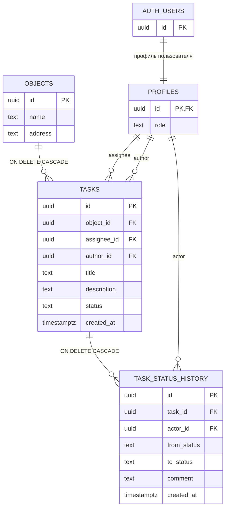

# ERD — проектная модель данных

Основа — ERD, предоставленная пользователем. В этапе 1 таблицы не созданы.
К минимальной схеме добавлены `tasks.title`, `tasks.description`,
`tasks.created_at`, обязательные по ТЗ. Связи с Auth и actor показаны явно
как предлагаемые уточнения целостности. `display_name` не требуется и исключён.

## Правила из архитектуры и ТЗ

- `tasks.object_id → objects.id ON DELETE CASCADE`.
- `task_status_history.task_id → tasks.id ON DELETE CASCADE`.
- Hard delete: без soft delete; история живёт до удаления задачи/объекта.
- Переназначение меняет доступ, сохраняет статус и предыдущую историю.
- Тип роли и статусов — `text`, как в предоставленной архитектуре.
- Время истории — `task_status_history.created_at` (не `changed_at`).
- Автор, время создания, actor, время истории определяются БД.

## Предлагаемые уточнения для миграций

- `profiles.id → auth.users.id`; роль не берётся из редактируемых пользователем
  метаданных. Роли `manager` и `executor` ограничиваются CHECK.
- Статусы `new`, `in_progress`, `in_review`, `accepted`, `rework` ограничиваются
  CHECK для всех трёх текстовых полей статуса. Это не заменяет проверку переходов.
- Ссылки на profiles — RESTRICT; удаление пользователей не входит в задание.
- Поля обязательны, кроме `from_status` при создании и необязательного комментария.
  Описание допускает пустую строку; названия и адрес непустые после trim.
- Создание записывается в историю как `NULL → new`. При возврате на доработку
  комментарий непустой после trim.
- Даты — `timestamptz`, отображение с учётом часового пояса пользователя.
- Индексы: `tasks(object_id)`, `tasks(assignee_id)`,
  `task_status_history(task_id, created_at)`.
- Смена статуса и запись истории атомарны; критические изменения выполняются
  SQL-функциями. Матрица переходов и защита истории — [ADR-002](adr/ADR-002.md).

Таблицы участников объекта нет: доступ исполнителя к объекту определяется
наличием его текущих задач. Внутри объекта он видит только свои задачи.
