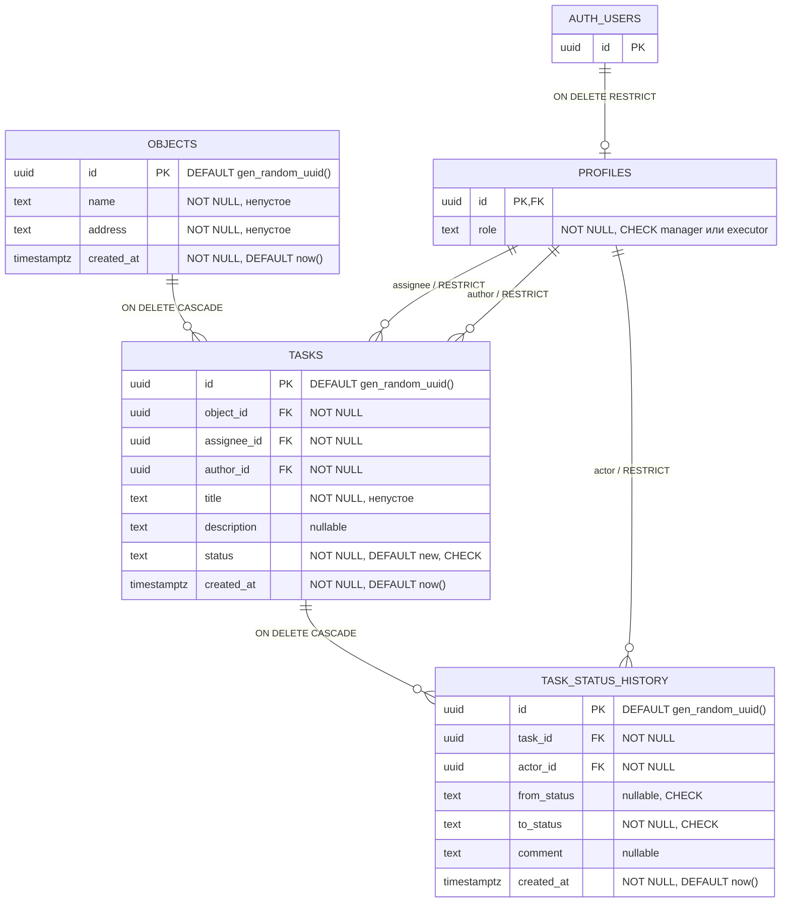

# ERD — текущая схема и доступ после Stage 5

Таблицы созданы первой миграцией, последующие пять добавляют права и функции,
не меняя структуру таблиц. Все версии находятся в [migrations](../supabase/migrations).
Облачный проект в Stage 6A не разворачивается. `auth.users` принадлежит Supabase;
прикладные миграции её не создают. Email читается из Auth через защищённые RPC,
не является новым столбцом profiles/tasks/history.

## Ограничения и удаление

- Роль: `manager` или `executor`, CHECK + NOT NULL.
- Все три поля статуса проверяются CHECK: `new`, `in_progress`, `in_review`,
  `accepted`, `rework`. `from_status` допускает NULL, остальные статусы — нет.
- `objects.name`, `objects.address`, `tasks.title` должны содержать хотя бы один
  непробельный символ (`~ '[^[:space:]]'`): пустая строка, пробелы, табы и переводы
  строк отклоняются. Введённые значения не обрезаются и не переписываются.
- `description` и `comment` допускают NULL и пустую строку по заданию Stage 2.
- Все ID — UUID; для объектов, задач и истории БД генерирует ID по умолчанию.
  `profiles.id` задаётся существующим `auth.users.id`.
- Hard delete: удаление объекта каскадно удаляет задачи и их историю; удаление
  задачи — только её историю. Несвязанные записи и профили остаются.
- `profiles.id → auth.users.id ON DELETE RESTRICT`: пользователь с профилем
  не удаляется. Ссылки author/assignee/actor на профиль также RESTRICT.
  Это исключает каскадное уничтожение бизнес-данных при удалении пользователя.
- Все `created_at` — `timestamptz NOT NULL DEFAULT now()`.

## Индексы

PK автоматически создают уникальные индексы. Дополнительно:

| Индекс | Колонки | Назначение |
| --- | --- | --- |
| `objects_created_at_idx` | `created_at DESC, id` | список объектов по времени |
| `tasks_object_id_created_at_idx` | `object_id, created_at DESC, id` | задачи объекта, FK/каскад |
| `tasks_assignee_id_created_at_idx` | `assignee_id, created_at DESC, id` | мои задачи, FK, RLS |
| `tasks_author_id_idx` | `author_id` | FK автора |
| `task_status_history_task_id_created_at_idx` | `task_id, created_at, id` | история задачи, FK/каскад |
| `task_status_history_actor_id_idx` | `actor_id` | FK участника истории |

Каждый FK покрыт индексом с нужной первой колонкой, включая PK `profiles.id`.
Отдельный индекс статусов пока не вводится: его необходимость определяется
реальной нагрузкой, отдельного фильтра статусов сейчас нет.

## Текущие права и операции

На profiles, objects, tasks и task_status_history включён RLS; FORCE RLS нет.
Anon/PUBLIC не имеют табличных прав. Authenticated читает только свой профиль;
клиентское изменение профиля/роли не разрешено.

Manager читает все объекты/задачи. Executor читает только назначенные задачи и
объекты с ними. Objects INSERT/UPDATE разрешены manager только для name/address;
tasks UPDATE — manager только для title/description. Удаление объектов/задач —
manager с сохранением CASCADE. Прямой INSERT tasks и UPDATE служебных полей запрещены.

История: authenticated имеет SELECT с history_select_visible_task по видимой
строке tasks; прямых клиентских INSERT/UPDATE/DELETE/TRUNCATE нет. Цепочки policies
objects → tasks → profiles и history → tasks → profiles ацикличны.

## RPC и аудит

- create_task: manager, проверенный executor, author_id=auth.uid(), status=new;
  задача и событие NULL → new создаются атомарно.
- transition_task: точная матрица переходов и комментарий возврата, FOR UPDATE,
  атомарный статус/история. Accepted терминальный.
- reassign_task: manager, новый профиль executor, FOR UPDATE задачи/FOR SHARE
  профиля. Любой статус, включая accepted; статус и история сохраняются.
  Тот же исполнитель — no-op без UPDATE.
- list_executors: manager-only список id/email для выбора исполнителя.
- read_task: доступная задача с author_email/assignee_email.
- read_task_history: доступная история с actor_email, created_at ASC/id ASC.

Все функции SECURITY DEFINER, search_path пуст, PUBLIC/anon не имеют EXECUTE.
Проверки роли и доступа внутри RPC обязательны, поскольку владелец обходит RLS.
Пять функций явно принадлежат postgres; list_executors — роли применения миграции.
Перед релизом проверяются фактические владельцы всех функций.

Автор и время истории задаются сервером: actor_id=auth.uid(),
created_at=clock_timestamp(). У старых задач может не быть первичного события;
backfill не выполнялся. CHECK статуса сам по себе ограничивает только значение,
а переходы защищает transition_task и отсутствие прямого UPDATE-grant.
На уровне таблицы from_status всё ещё допускает NULL, description/comment — пустоту;
непустой комментарий rework проверяет RPC.

Переназначение меняет доступ к задаче и всей истории при новых запросах.
Прежний исполнитель не видит их, новый получает и прошлые события. Отдельной
истории назначений/редактирования полей нет. Уже загруженные страницы без
Realtime сами не очищаются. Администратор и service_role находятся вне обычной
модели пользовательских прав и могут изменять данные напрямую.

Детали сигнатур, policies и grants: [security-model](security-model.md).
Решения: [ADR-002](adr/ADR-002.md), [ADR-003](adr/ADR-003.md).
